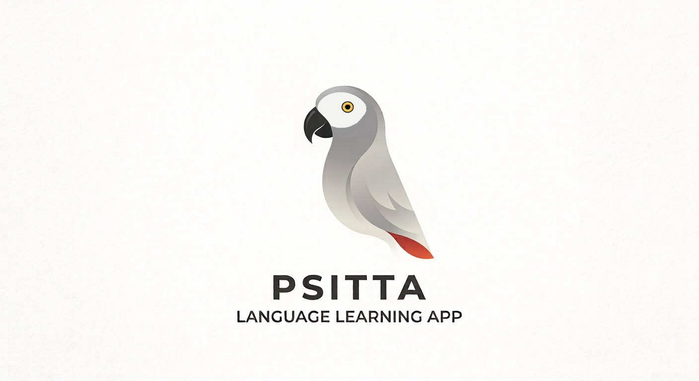

<p align="center">
  
</p>

# Psitta

[](https://flutter.dev)
[](https://dart.dev)
[](LICENSE)
[](docs/publication_plan.md)

**Psitta** is an open-source language learning application built with Flutter.
It combines vocabulary study and sentence practice with a custom spaced
repetition system: words introduce vocabulary, while groups of related sentences
provide practice with shared grammatical structures.

The project explores both language learning and the engineering behind a study
application. Its learning engine has an explicitly documented mathematical model,
with separate layers for the interface, application workflows, learning rules,
and persistence, so each part can evolve independently.

The first version focuses on **Japanese**, with **1,297 words and 1,380 sentence
groups (3,452 sentences)**, furigana, and English meanings and translations.

[Website](https://psitta.net) · [Documentation](docs/index.md) ·
[Report an issue](https://github.com/Antoine-Lagache/psitta/issues)

## Current features

- Separate word and sentence sessions, with answer grading and review intervals.
- Related sentences share a group-level schedule and individual exposure state.
- Pause/resume and local persistence of answers and learning progress.
- Today's and all-time activity statistics.
- Bundled Japanese fonts, source links and offline license notices.

The default session introduces at most four words or three sentence groups,
plus due reviews. This is a per-session limit, not an enforced daily quota.
The custom SRS model is documented; its learning effectiveness has not been
empirically established. Psitta is a study aid, not a complete Japanese course.

Audio playback is implemented, but this corpus contains no audio and no
text-to-speech feature is currently implemented. Settings are a placeholder.
Progress stays in the local database; cloud sync and a user-facing backup/export
workflow are not implemented.

## Download build candidates

Open [GitHub Actions → Build applications](https://github.com/Antoine-Lagache/psitta/actions/workflows/build_apps.yml),
select a successful run, then scroll to **Artifacts** and select `Psitta-windows-…`
(or another platform). GitHub requires sign-in and downloads these artifacts as
ZIP files. Extract the downloaded ZIP, then run the Windows `Psitta-…-setup.exe`
to install the app and add a Start menu shortcut. The portable ZIP is optional.
On Ubuntu 24.04 x64, download `Psitta-linux-…`, extract the ZIP, and install the
`.deb` with `sudo apt install ./psitta_0.1.0-2_amd64.deb` from that directory.
Psitta then appears in the applications menu. Older builds contain only the
portable archive.

These are temporary build artifacts (30-day retention), not GitHub Releases.
The Windows executable and installer are currently unsigned; Windows may show
an unknown-publisher or SmartScreen warning. An installer does not remove that
warning. See [build documentation](docs/builds.md).

## Platforms and release status

Version in source: **0.1.0+2**, preparing the first public distribution.

| Platform | Current status |
|---|---|
| Android | Native project present; manually exercised on the maintainer's phone. |
| Linux | Native project present; manually exercised on Ubuntu. |
| Windows | Build workflow generates the native project; manual validation pending. |
| macOS / iOS | Experimental unsigned builds in CI; no manual device testing yet. |
| Web | Unsupported: persistence uses native SQLite and `dart:io`. |

These manual checks do not certify every device or OS version. CI currently
runs formatting, static analysis and tests on Linux. A separate five-platform
[build workflow](docs/builds.md) produces downloadable candidates.
Android release builds still use debug signing; durable release signing is a
publication task. See the [publication plan](docs/publication_plan.md).

## Build from source

Use **Flutter 3.47.2** (the build workflow version) and the native toolchain for
the chosen target. The lockfile requires Dart >=3.12 and Flutter >=3.44. Keep
`pubspec.lock` for reproducible package resolution.

```sh
git clone https://github.com/Antoine-Lagache/psitta.git
cd psitta
flutter pub get
flutter test tools/build_bundled_database.dart
flutter run
```

Generate the bundled database before running, testing or building a fresh
checkout. On Debian/Ubuntu, native audio compilation may additionally require
`libasound2-dev` alongside the Flutter Linux build prerequisites.

## Developer documentation

Start with the [documentation index](docs/index.md) for architecture, persistence,
and the SRS specification. The main layers are UI, Application controllers,
Domain learning rules, and Infrastructure persistence. Domain code is independent
of Flutter and SQLite. See [content sources](docs/content_sources.md) for corpus
provenance and [database generation](docs/bundled_database.md) for installation
and progress-preserving migration requirements.

### Bundled exercises and installation

`assets/content/v0_1/` contains the frozen HTML corpus copied from
`psitta-content`, generated from the frozen editorial selection on 2026-10-19.
Its exact input hash and review status are retained in the bundled manifest:

| File | Contents |
|---|---|
| `manifest.json` | Format version, source checksum, counts and compressed/decoded checksums |
| `word_exercises.jsonl.gz` | 1,297 ordered word exercises, each with separate `front_html` and `back_html` |
| `sentence_exercises.jsonl.gz` | 1,380 ordered groups containing 3,452 sentence instances, each with its own front and back |

`tools/build_bundled_database.dart` runs the application migrations and
`ReleaseContentImporter` ahead of distribution, generating
`assets/database/psitta.db.gz` and its checksum manifest. Both generated files
are ignored by Git; generate them before running tests, the app, or a build.
CI generates them automatically. A new installation
verifies and atomically copies this snapshot, avoiding thousands of SQL calls
at startup. Existing databases run their pending migrations without replacement.
The transactional importer remains a recovery path for existing empty databases.
The snapshot contains 2,677 exercises, 4,749 content records, two HTML field
definitions (front/back), sentence groups, instance states and initial SRS states. Word exercise IDs
follow the word order; sentence exercise IDs follow the group order. The
learning session may shuffle its selected exercises.

Existing development installations with synthetic exercises keep their data;
to test a clean install, clear application data or remove `psitta.db` from the
application-support directory. `DevelopmentDataSeeder` remains available to
test media rendering explicitly, but is no longer called on normal startup.

The current export preserves the final 2026-10-19 word/group order and includes aligned
furigana, JMdict labels and Tatoeba links on all sentence cards. Fifteen justified
translation flags preserve the Tatoeba translation alongside a clearly labelled,
unverified AI suggestion. The upstream manifest still records `release_ready: false`
because contextual reading review is incomplete; integration does not certify
linguistic correctness.

Ten corrected word cards explicitly attribute sense selection and usage notes to
ChatGPT while retaining JMdict attribution for dictionary glosses. The corrected
reading of 訳 is やく. The recommended 4-word / up-to-3-group schedule is retained
as export metadata; the application does not enforce that joint timetable.

The import is a one-time installation of v0.1. Updating a populated database
to a revised corpus will need a versioned content migration that preserves
learning progress. For the regeneration command and migration workflow, see
[bundled database generation](docs/bundled_database.md).

Run the same checks as CI with:

```bash
flutter test tools/build_bundled_database.dart
dart format --output=none --set-exit-if-changed lib test tools
flutter analyze
flutter test
```

---

## License

The application code is licensed under MIT; see [`LICENSE`](LICENSE).
The bundled learning content has separate source licenses. JMdict and OpenJLPT
use CC BY-SA 4.0, and the underlying Tatoeba sentences use CC BY 2.0 France.
The Psitta learning-content compilation and adaptations use CC BY-SA 4.0.
Consolidated credits and license references are accessible through
**Settings → About Psitta → Sources and licenses**. The shared CC BY-SA license,
EDRDG statement and required JMdict documentation are bundled in `assets/legal/`. See
[content sources](docs/content_sources.md) for provenance and maintenance notes.
